# 📷 Phototake Management App — Showcase
  
---

## About the Project

**Phototake Management App** is a centralized mobile platform designed to streamline the daily operations of a photography studio in Kuching, Sarawak. It replaces fragmented manual methods (spreadsheets, messaging apps, and social media) with a single digital workflow where staff and administrators can manage bookings, track job progress, and monitor business performance.

This project was developed by **Group CodeC** for **TMA3084 Software Engineering Laboratory** at Universiti Malaysia Sarawak (UNIMAS).

### The Problem

Before this system, the studio handled client records, scheduling, and job tracking across several disconnected channels. This led to:

- Double-bookings and missed appointments
- Scattered client and job information
- No central view of job progress or financial status
- Time spent on administration instead of creative work

### The Solution

A role-based Android application, built with Flutter and Firebase, that gives staff a real-time shared calendar, structured job tracking, and an admin dashboard with analytics and AI-generated reports.

---

## Project Status

| Phase | Description | Status |
|-------|-------------|--------|
| Requirements | SRS document and stakeholder meetings | ✅ Completed |
| Design | UML diagrams, UI wireframes, data dictionary | ✅ Completed |
| Implementation | Flutter app and Firebase backend | ✅ Completed |

---

## Key Features

🔐 **Role-based access control** with distinct interfaces for Admin and Staff  
📅 **Booking management** with a real-time calendar and conflict prevention  
🛠️ **Job tracking** from "Shooting" through to "Ready for Delivery"  
👥 **Staff management** where admins add staff through referral codes and can reset passwords  
📦 **Package management** so admins can add, edit, and remove service packages  
📊 **Analytics dashboard** with job completion, revenue, and package trend charts  
🤖 **AI integration** using the Gemini API to generate summary reports and smart captions  
📄 **PDF report export** for business summaries  
🔔 **Notifications** with daily booking reminders and job deadline alerts  
📴 **Offline capability** so staff can view their schedule without an internet connection  

---

## User Roles

| Role | Description | Key Capabilities |
|------|-------------|------------------|
| **Staff** | Day-to-day users such as photographers | View schedule, add bookings, update job progress, receive reminders |
| **Administrator** | Studio owner or manager | All staff functions, assign bookings to staff, manage staff and packages, view analytics, generate reports |

---

## Tech Stack

| Layer | Technology |
|-------|-----------|
| **Frontend** | Flutter, Dart |
| **State Management** | Riverpod / Provider |
| **Authentication** | Firebase Authentication |
| **Database** | Cloud Firestore |
| **Server Logic** | Firebase Cloud Functions |
| **File Storage** | Firebase Cloud Storage |
| **Notifications** | Firebase Cloud Messaging (FCM) |
| **AI** | Gemini API |
| **Version Control** | Git and GitHub |

---

## Application Screenshots  

### Login  
| Admin | Staff |
|:---:|:---:|
| 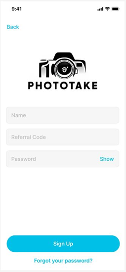 | 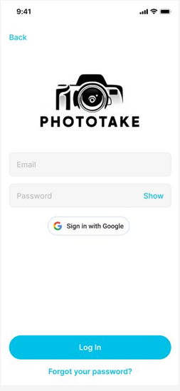 |   

### Dashboard
| Admin | Staff |
|:---:|:---:|
| 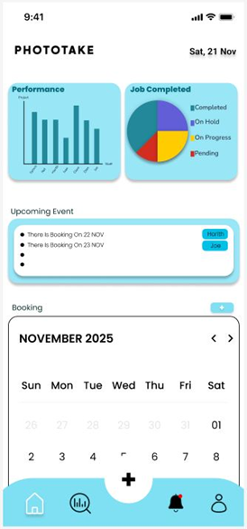 | 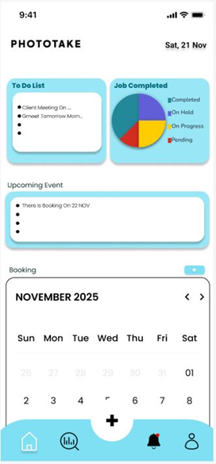 |

### Booking Form
| Admin | Staff |
|:---:|:---:|
| 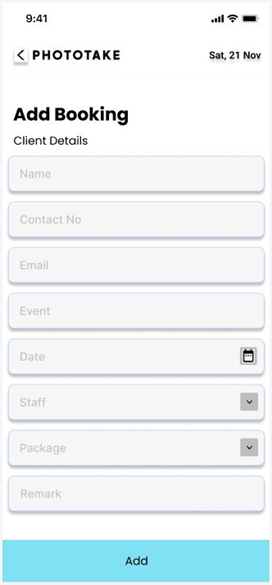 | 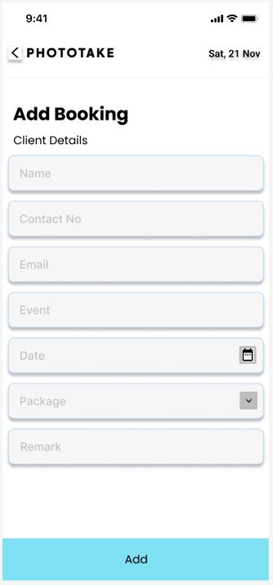 |  

### Analytics Page
| Admin | Staff |
|:---:|:---:|
| 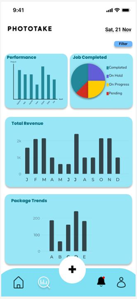 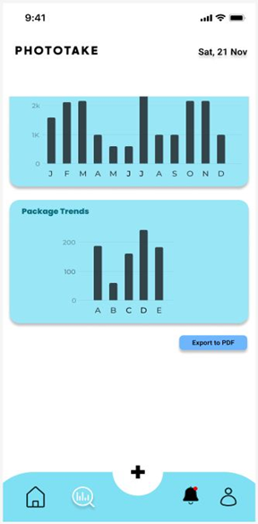 | 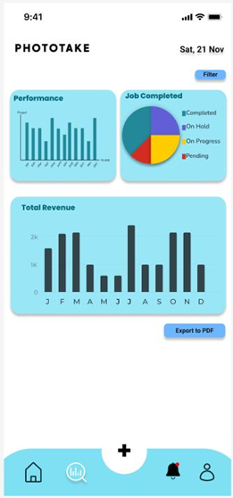 |

### Notification Page
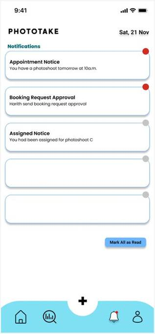 

### Settings & Configuration
| Admin | Staff |
|:---:|:---:|
| 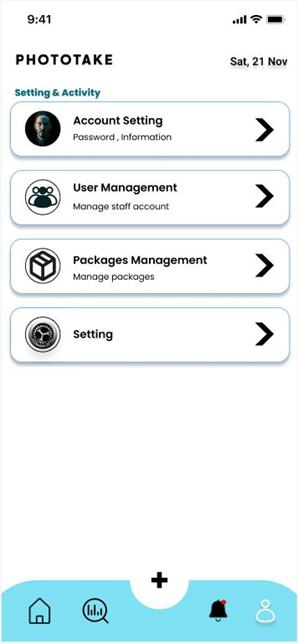 | 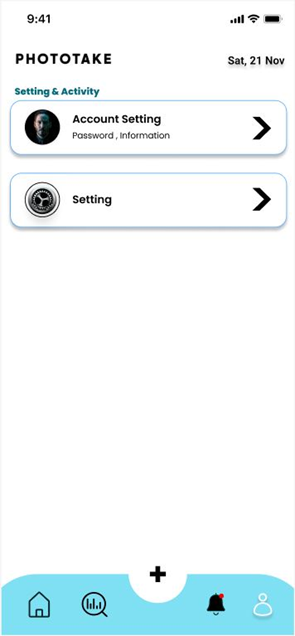 |  

### User management and package management page
| User management | Package management|
|:---:|:---:|
| 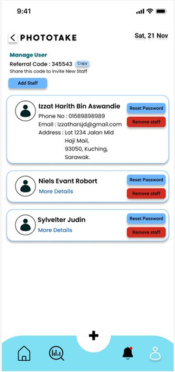 | 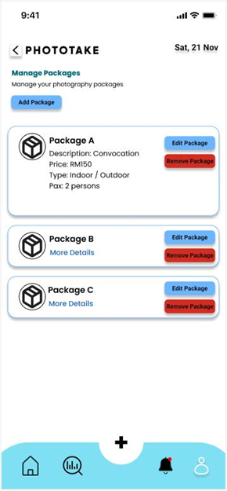 |    

---

## System Design

### Data Flow Diagram

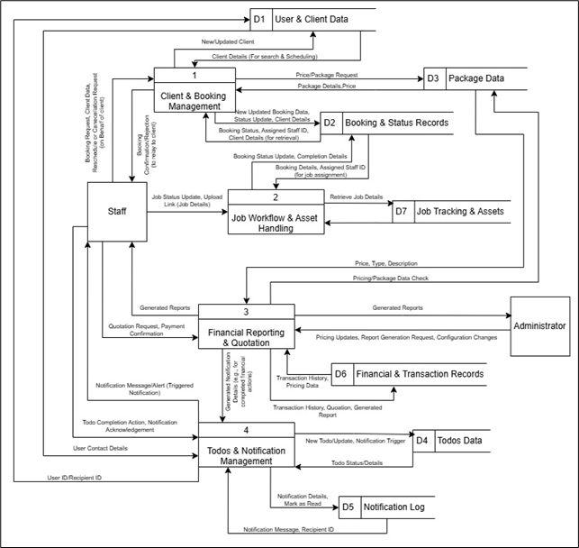

### Use Case Diagram

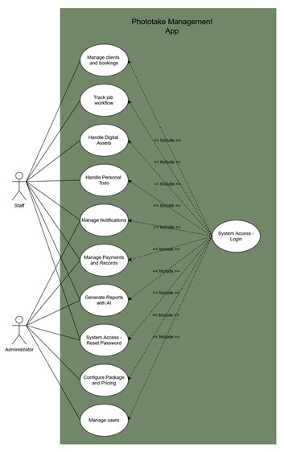

### Class Diagram

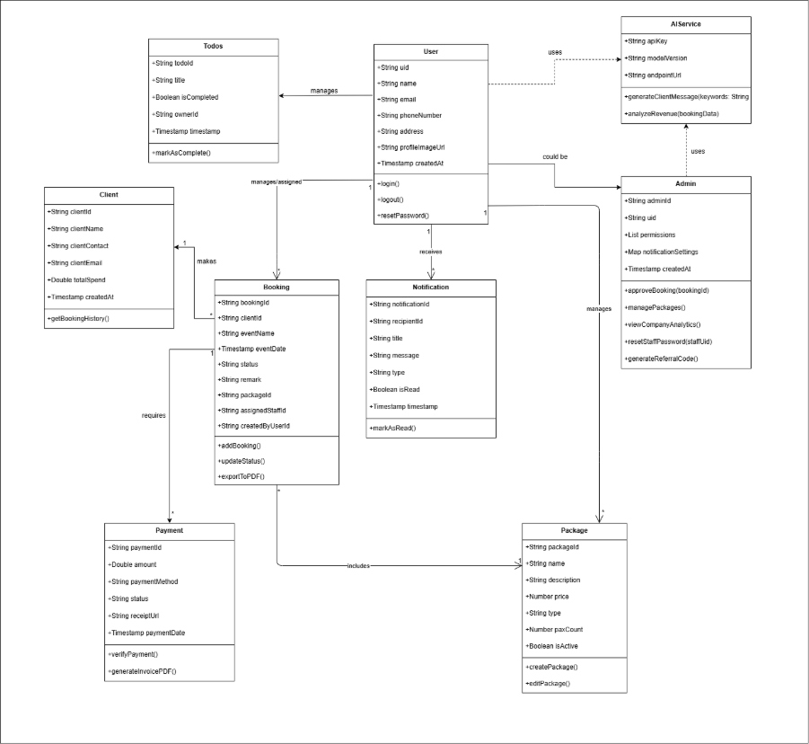

### Activity Diagrams

**Staff Booking Process**

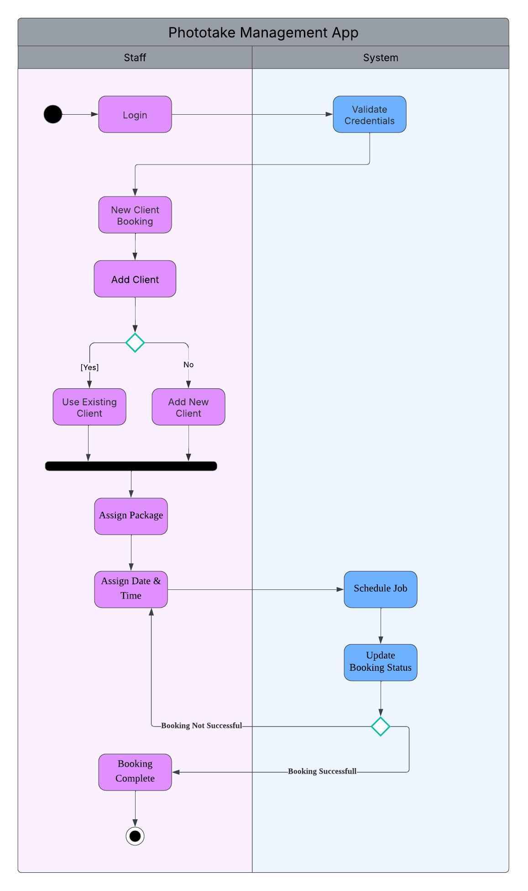

**Admin Booking Process**

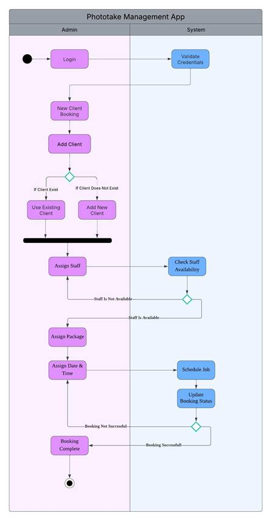

**Admin Manage Staff Process**

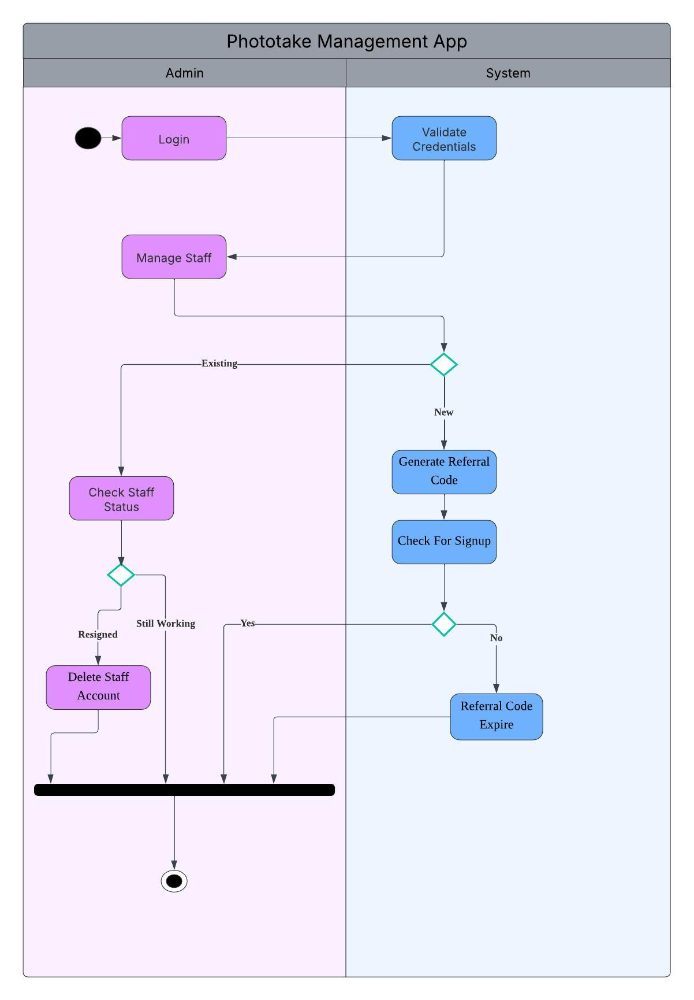

**Admin Manage Packages Process**

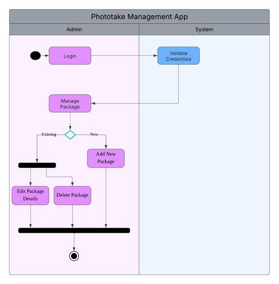

---

## Code Organisation

The codebase separates logic, UI, and data models for scalability.

| Folder | Responsibility |
|--------|---------------|
| `core/` | Global configuration: color palette, app theme, constants |
| `models/` | Data classes for users, bookings, packages, and to-dos |
| `services/` | Backend logic: authentication, Firestore operations, AI service, notifications |
| `providers/` | State management for the current user and bookings |
| `widgets/` | Reusable UI components such as booking cards and the AI report card |
| `screens/` | App pages grouped into `auth`, `admin`, `staff`, and `shared` |

---

## Development Methodology

The project follows **Agile Scrum**. Each sprint produced a working, testable increment, which supported steady feedback and iteration.

Requirements were gathered through meetings with the studio owner and group discussions covering user roles, booking fields, analytics widgets, and notification behaviour. Full details are in the [Software Requirements Specification](docs/SRS.pdf).

---

## Team: Group CodeC

| Name | Role |
|------|------|
| Niels Evant Robort | Group Leader |
| Sylvelter Judin | Assistant Leader |
| Ivan Isaac Lupang | Secretary |
| Clare Cassandra | Team Member |
| Izzat Harith Bin Aswandie | Team Member |
| Syajaratul Diana Bt A.Razak | Team Member |

**Course:** TMA3084 Software Engineering Laboratory, Faculty of Computer Science and Information Technology, UNIMAS

---

## Acknowledgments

- The studio owner, for her cooperation in defining requirements and sharing insight into daily operations
- **Ts. Mdm. Nurfauza binti Jali**, course instructor, for supervision and guidance throughout TMA3084

---

## Repository Privacy Notice

This public showcase intentionally **does not include**:

- Application source code
- Firebase configuration files
- API keys and authentication secrets
- Real client data

Screenshots use sample data only.

---

## Repository Structure

```
Phototake-Showcase/
├── README.md
├── LICENSE
├── assets/
│   ├── banner.png
│   ├── login.png
│   ├── dashboard.png
│   ├── booking-form.png
│   ├── analytics.png
│   ├── notifications.png
│   ├── settings.png
│   ├── user-management.png
│   ├── package-management.png
│   ├── dfd.png
│   ├── use-case-diagram.png
│   ├── class-diagram.png
│   ├── activity-staff-booking.png
│   ├── activity-admin-booking.png
│   ├── activity-manage-staff.png
│   └── activity-manage-packages.png
```

---

## Connect With Me

- GitHub: [@Neo-Dean](https://github.com/Neo-Dean)
- LinkedIn: [Syajaratul Diana Bt A.Razak](https://www.linkedin.com/in/your-profile)

---

## License

Copyright © 2026 Group CodeC. All rights reserved.

This repository is provided for **portfolio, documentation, demonstration, and academic reference purposes only**. Project source code remains private.
